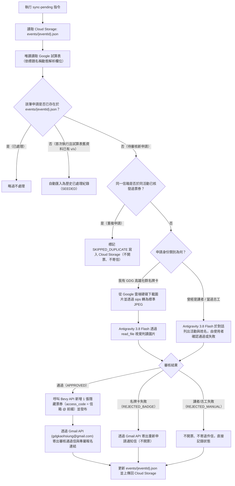

# GDG 活動免費入場審核自動化系統實作規格書（Gemini 3.8 Flash 專用）

> [!IMPORTANT]
> **給實作模型（Gemini 3.8 Flash）的執行守則**：
> 1. 本文件為零歧義規格書，請依序從 **步驟 1** 執行至 **步驟 7**，不得跳過任何檔案或自行省略欄位轉換邏輯。
> 2. **禁止呼叫外部付費模型**：本系統採用「Node.js 確定性工具腳本 + Antigravity 專案技能（`SKILL.md`）」混合架構。名牌卡圖片的視覺判讀由使用者在 Antigravity 命令列介面（Command Line Interface）對話中，透過內建 `read_file` 工具讀取轉檔後的圖片完成（使用 Google AI Pro 訂閱額度，額外應用程式介面（Application Programming Interface）費用為 0 元）。
> 3. **專案隔離與跨電腦路徑原則**：本專案預設建立於 `~/Project/gdg_free_ticket_verifier`（或當前工作目錄），不得依賴、引用或連線至 `gdg-platfrom-tool` 專案之任何程式碼或資料庫。所有路徑皆使用相對路徑或 `os.homedir()`，不寫死特定電腦的使用者名稱。
> 4. **不回寫 Google 試算表**：所有Google 試算表與 Google 雲端硬碟操作皆為唯讀；審核狀態、開票紀錄與多活動設定統一儲存於 `agy-gcp-control` 專案位於 `us-central1` 區域的 Google Cloud Storage 儲存桶（路徑：`gs://<GCS_BUCKET_NAME>/events/<eventId>.json`）。

---

## 1. 系統架構與流程全覽



---

## 2. 專案目錄結構

請在 `~/Project/gdg_free_ticket_verifier`（或當前專案根目錄）建立以下完整目錄結構：

```text
gdg_free_ticket_verifier/
├── .env.example
├── .gitignore
├── package.json
├── tsconfig.json
├── src/
│   ├── types.ts                # 所有資料結構與型別定義
│   ├── config.ts               # 環境變數（Environment Variable）與本機憑證路徑管理
│   ├── auth-google.ts          # Google 開放授權（Open Authorization）2.0 登入與憑證管理
│   ├── auth-bevy.ts            # Bevy 瀏覽器登入（Playwright）與 Cookie 擷取管理
│   ├── gcs-state.ts            # Cloud Storage (us-central1) 多活動 JSON 狀態讀寫與初始化
│   ├── sheets-reader.ts        # Google 試算表動態欄位唯讀解析與 Google 雲端硬碟圖片下載 + sips 轉檔
│   ├── bevy-client.ts          # Bevy 取得活動詳情、新增隱藏票種、欄位正規化與發布 API
│   ├── gmail-sender.ts         # Gmail API 寄送審核通過信與名牌卡退件信（RFC 2822 Base64URL 編碼）
│   └── cli.ts                  # 命令列介面入口（提供給 Antigravity Skill 呼叫的確定性子指令）
└── .agent/
    └── skills/
        └── verify-free-tickets/
            └── SKILL.md        # 供 Antigravity 讀取並執行審核工作流的技能定義檔
```

---

## 3. 逐步實作規範（Step-by-Step Implementation）

### 步驟 1：初始化專案與設定檔

1. 建立專案資料夾並寫入 `package.json`、`tsconfig.json`、`.gitignore` 與 `.env.example`。

#### `package.json`
```json
{
  "name": "gdg-free-ticket-verifier",
  "version": "1.0.0",
  "private": true,
  "description": "GDG event free admission verifier, Bevy hidden ticket creator, and Gmail notifier",
  "scripts": {
    "build": "tsc",
    "cli": "tsx src/cli.ts",
    "auth:google": "tsx src/cli.ts auth-google",
    "auth:bevy": "tsx src/cli.ts auth-bevy",
    "init:event": "tsx src/cli.ts init-event",
    "fetch:pending": "tsx src/cli.ts fetch-pending",
    "approve": "tsx src/cli.ts approve",
    "reject": "tsx src/cli.ts reject"
  },
  "dependencies": {
    "@google-cloud/storage": "^7.14.0",
    "dotenv": "^16.4.7",
    "googleapis": "^144.0.0",
    "playwright": "^1.49.0"
  },
  "devDependencies": {
    "@types/node": "^22.10.0",
    "tsx": "^4.19.2",
    "typescript": "^5.7.2"
  }
}
```

#### `tsconfig.json`
```json
{
  "compilerOptions": {
    "target": "ES2022",
    "module": "CommonJS",
    "moduleResolution": "Node",
    "outDir": "./dist",
    "rootDir": "./src",
    "strict": true,
    "esModuleInterop": true,
    "skipLibCheck": true,
    "forceConsistentCasingInFileNames": true,
    "resolveJsonModule": true
  },
  "include": ["src/**/*"]
}
```

#### `.gitignore`
```text
node_modules/
dist/
.env
.credentials/
tmp/
.DS_Store
```

#### `.env.example`
```dotenv
# Google Cloud 與 Cloud Storage 設定（固定使用 agy-gcp-control 的 us-central1 免費區域）
GCP_PROJECT_ID=agy-gcp-control
GCS_BUCKET_NAME=agy-gcp-control-free-ticket-verifier
GCS_BUCKET_LOCATION=us-central1

# 預設操作的 Bevy 活動 ID（DevFest Kaohsiung 2026 為 129908，可透過 CLI --event-id 覆寫）
DEFAULT_EVENT_ID=129908

# Google OAuth 2.0 桌面用戶端憑證檔案路徑（供 gdgkaohsiung@gmail.com 授權使用）
GOOGLE_OAUTH_CLIENT_PATH=./.credentials/google_oauth_client.json
GOOGLE_OAUTH_TOKEN_PATH=./.credentials/google_oauth_token.json

# （選填）用於讀取試算表、下載圖片與存取 Cloud Storage 的服務帳戶（Service Account）金鑰路徑
# 若未設定，預設自動尋找 ~/.gemini/config/plugins/antigravity-google-drive/credentials.json 或使用上方 Google OAuth 2.0 憑證
GOOGLE_SERVICE_ACCOUNT_PATH=

# Bevy 認證（可執行 npm run auth:bevy 自動擷取存入 .credentials/bevy_session.json，或在此手動填入覆寫）
BEVY_SESSION_ID=
BEVY_CSRF_TOKEN=
```

---

### 步驟 2：實作型別定義與環境設定（`src/types.ts` 與 `src/config.ts`）

#### `src/types.ts`
```typescript
export type IdentityCategory = 'BADGE' | 'SPEAKER' | 'VOLUNTEER' | 'UNKNOWN';

export type VerificationStatus =
  | 'SEEDED_PASS'       // 從試算表歷史紀錄匯入（已寄信且已開票）
  | 'SEEDED_FAIL'       // 從試算表歷史紀錄匯入（已處理為不通過或略過）
  | 'APPROVED'          // 審核通過（已開 Bevy 隱藏票並寄出通過信）
  | 'REJECTED_BADGE'    // 名牌卡審核不通過（不開票，已寄出重新申請信）
  | 'REJECTED_MANUAL'   // 講者或志工審核不通過（不開票、不寄信）
  | 'SKIPPED_DUPLICATE';// 同一信箱重複申請或同批舊件（不開票、不寄信）

export interface EventTemplateConfig {
  eventId: number;
  chapterId: number;
  eventSlug: string;
  eventName: string;
  eventUrl: string; // 例如 https://gdg.community.dev/events/details/google-gdg-kaohsiung-presents-devfest-kaohsiung-2026/
  spreadsheetId: string;
  sheetName: string;
  senderEmail: string;
  badgeTicketTitle: string;
  speakerVolunteerTicketTitle: string;
  approvalEmailSubject: string;
  rejectionEmailSubject: string;
  rsvpDeadlineText: string;     // 例如 "11 月 10 日 18:00 前"
  applicationFormTitle: string; // 例如 "DevFest 2026 高雄場免費入場申請"
  eventInfoBlock: string;       // 活動資訊區塊文字
}

export interface ProcessedSubmissionRecord {
  recordKey: string;            // 格式: `${timestamp}|${email.toLowerCase()}`
  rowNumber: number;
  timestamp: string;
  email: string;
  rawIdentity: string;
  identityCategory: IdentityCategory;
  status: VerificationStatus;
  emailSent: boolean;
  extractedName: string;
  ticketTitle: string;
  accessCode: string;
  ticketUrl: string;
  note: string;
  processedAt: string;
}

export interface EventStateFile {
  config: EventTemplateConfig;
  updatedAt: string;
  records: Record<string, ProcessedSubmissionRecord>;
}

export interface PendingApplicationItem {
  recordKey: string;
  rowNumber: number;
  timestamp: string;
  email: string;
  accessCode: string;
  rawIdentity: string;
  identityCategory: IdentityCategory;
  volunteerEventName: string;
  volunteerName: string;
  speakerEventName: string;
  speakerName: string;
  driveFileUrl: string;
  driveFileId: string;
  localImagePath: string | null;
  duplicateOfRecordKey: string | null;
}

export interface BevyCredentials {
  sessionId: string;
  csrfToken: string;
  updatedAt: string;
}
```

#### `src/config.ts`
```typescript
import * as path from 'path';
import * as fs from 'fs';
import * as os from 'os';
import * as dotenv from 'dotenv';
import { EventTemplateConfig } from './types';

dotenv.config();

export const PROJECT_ROOT = path.resolve(__dirname, '..');
export const CREDENTIALS_DIR = path.join(PROJECT_ROOT, '.credentials');
export const TMP_IMAGE_DIR = path.join(PROJECT_ROOT, 'tmp', 'images');

export const GCP_PROJECT_ID = process.env.GCP_PROJECT_ID || 'agy-gcp-control';
export const GCS_BUCKET_NAME = process.env.GCS_BUCKET_NAME || 'agy-gcp-control-free-ticket-verifier';
export const GCS_BUCKET_LOCATION = process.env.GCS_BUCKET_LOCATION || 'us-central1';
export const DEFAULT_EVENT_ID = Number(process.env.DEFAULT_EVENT_ID || '129908');

export const GOOGLE_OAUTH_CLIENT_PATH = path.resolve(
  PROJECT_ROOT,
  process.env.GOOGLE_OAUTH_CLIENT_PATH || './.credentials/google_oauth_client.json'
);
export const GOOGLE_OAUTH_TOKEN_PATH = path.resolve(
  PROJECT_ROOT,
  process.env.GOOGLE_OAUTH_TOKEN_PATH || './.credentials/google_oauth_token.json'
);
export const GOOGLE_SERVICE_ACCOUNT_PATH = process.env.GOOGLE_SERVICE_ACCOUNT_PATH
  ? path.resolve(PROJECT_ROOT, process.env.GOOGLE_SERVICE_ACCOUNT_PATH)
  : path.join(os.homedir(), '.gemini/config/plugins/antigravity-google-drive/credentials.json');

export const BEVY_SESSION_PATH = path.join(CREDENTIALS_DIR, 'bevy_session.json');

export function ensureDirectories(): void {
  fs.mkdirSync(CREDENTIALS_DIR, { recursive: true });
  fs.mkdirSync(TMP_IMAGE_DIR, { recursive: true });
}

export const DEVFEST_2026_DEFAULT_CONFIG: EventTemplateConfig = {
  eventId: 129908,
  chapterId: 739,
  eventSlug: 'google-gdg-kaohsiung-presents-devfest-kaohsiung-2026',
  eventName: 'DevFest 2026 高雄場',
  eventUrl: 'https://gdg.community.dev/events/details/google-gdg-kaohsiung-presents-devfest-kaohsiung-2026/',
  spreadsheetId: '1Vwc1j7wBJUBdByJ1hU9Q-Tvfp9iiS6uIzgMkBk0eSms',
  sheetName: '免費入場表單',
  senderEmail: 'gdgkaohsiung@gmail.com',
  badgeTicketTitle: '我要參加 DevFest 高雄場，有 GDG 高雄社群名牌卡免費入場',
  speakerVolunteerTicketTitle: '我要參加 DevFest 高雄場，曾經是講者或志工免費入場',
  approvalEmailSubject: '您已成功取得 DevFest 2026 高雄場的免費入場資格',
  rejectionEmailSubject: '請重新申請 DevFest 2026 高雄場免費入場',
  rsvpDeadlineText: '11 月 10 日 18:00 前',
  applicationFormTitle: 'DevFest 2026 高雄場免費入場申請',
  eventInfoBlock: [
    '官網：https://gdgkh.cc',
    '日期：11/14（六）',
    '地點：KO-IN 智高點（信義國小站 3 號出口過馬路）',
    '地址：高雄市新興區中正三路 25 號 14 樓',
    'Google Map：https://maps.app.goo.gl/Z1wryFWcguicjpYd8',
  ].join('\n'),
};
```

---

### 步驟 3：實作 Google 與 Bevy 認證模組（`src/auth-google.ts` 與 `src/auth-bevy.ts`）

#### `src/auth-google.ts`
* 支援兩種認證來源：
  1. **讀取試算表與下載 Google 雲端硬碟圖片**：優先使用 Google OAuth 2.0 憑證；若本機存在唯讀服務帳戶憑證（`GOOGLE_SERVICE_ACCOUNT_PATH`），亦可直接用於唯讀讀取試算表與雲端硬碟圖片。
  2. **Gmail 寄信（`gdgkaohsiung@gmail.com`）**：必須使用 Google OAuth 2.0 憑證（含 `https://www.googleapis.com/auth/gmail.send` 權限範圍）。

```typescript
import * as fs from 'fs';
import * as http from 'http';
import { URL } from 'url';
import { execSync } from 'child_process';
import { google } from 'googleapis';
import {
  GOOGLE_OAUTH_CLIENT_PATH,
  GOOGLE_OAUTH_TOKEN_PATH,
  GOOGLE_SERVICE_ACCOUNT_PATH,
  ensureDirectories,
} from './config';

const OAUTH_SCOPES = [
  'https://www.googleapis.com/auth/gmail.send',
  'https://www.googleapis.com/auth/spreadsheets.readonly',
  'https://www.googleapis.com/auth/drive.readonly',
  'https://www.googleapis.com/auth/devstorage.read_write',
];

export function createOAuth2Client() {
  if (!fs.existsSync(GOOGLE_OAUTH_CLIENT_PATH)) {
    throw new Error(
      `找不到 Google OAuth 2.0 用戶端憑證檔：${GOOGLE_OAUTH_CLIENT_PATH}\n` +
      `請在 Google Cloud Console (agy-gcp-control) 建立「桌面應用程式 (Desktop App)」OAuth 2.0 用戶端 ID，並下載 JSON 存至此路徑。`
    );
  }
  const raw = JSON.parse(fs.readFileSync(GOOGLE_OAUTH_CLIENT_PATH, 'utf8'));
  const creds = raw.installed || raw.web;
  if (!creds) {
    throw new Error(`無效的 OAuth 憑證格式：${GOOGLE_OAUTH_CLIENT_PATH}`);
  }
  return new google.auth.OAuth2(
    creds.client_id,
    creds.client_secret,
    'http://localhost:45678/oauth2callback'
  );
}

export function getAuthorizedGoogleOAuthClient() {
  const oAuth2Client = createOAuth2Client();
  if (!fs.existsSync(GOOGLE_OAUTH_TOKEN_PATH)) {
    throw new Error(
      `尚未完成 Google OAuth 登入，找不到 ${GOOGLE_OAUTH_TOKEN_PATH}。請先執行 npm run auth:google`
    );
  }
  const tokens = JSON.parse(fs.readFileSync(GOOGLE_OAUTH_TOKEN_PATH, 'utf8'));
  oAuth2Client.setCredentials(tokens);
  oAuth2Client.on('tokens', (newTokens) => {
    const merged = { ...tokens, ...newTokens };
    fs.writeFileSync(GOOGLE_OAUTH_TOKEN_PATH, JSON.stringify(merged, null, 2), 'utf8');
  });
  return oAuth2Client;
}

export function getReadOnlyDriveAndSheetsAuth() {
  if (fs.existsSync(GOOGLE_OAUTH_TOKEN_PATH) && fs.existsSync(GOOGLE_OAUTH_CLIENT_PATH)) {
    return getAuthorizedGoogleOAuthClient();
  }
  if (fs.existsSync(GOOGLE_SERVICE_ACCOUNT_PATH)) {
    return new google.auth.GoogleAuth({
      keyFile: GOOGLE_SERVICE_ACCOUNT_PATH,
      scopes: [
        'https://www.googleapis.com/auth/spreadsheets.readonly',
        'https://www.googleapis.com/auth/drive.readonly',
      ],
    });
  }
  throw new Error('找不到可用的 Google 試算表/雲端硬碟認證憑證，請執行 npm run auth:google');
}

export async function runInteractiveGoogleLogin(): Promise<void> {
  ensureDirectories();
  const oAuth2Client = createOAuth2Client();
  const authorizeUrl = oAuth2Client.generateAuthUrl({
    access_type: 'offline',
    prompt: 'consent',
    scope: OAUTH_SCOPES,
  });

  console.log('正在啟動瀏覽器進行 Google OAuth 2.0 授權（請使用 gdgkaohsiung@gmail.com 登入）...');
  console.log('授權網址：', authorizeUrl);

  await new Promise<void>((resolve, reject) => {
    const server = http.createServer(async (req, res) => {
      try {
        if (!req.url || !req.url.startsWith('/oauth2callback')) return;
        const reqUrl = new URL(req.url, 'http://localhost:45678');
        const code = reqUrl.searchParams.get('code');
        if (!code) {
          res.writeHead(400, { 'Content-Type': 'text/plain; charset=utf-8' });
          res.end('未取得授權碼 (code)');
          return;
        }
        const { tokens } = await oAuth2Client.getToken(code);
        fs.writeFileSync(GOOGLE_OAUTH_TOKEN_PATH, JSON.stringify(tokens, null, 2), 'utf8');
        res.writeHead(200, { 'Content-Type': 'text/plain; charset=utf-8' });
        res.end('Google OAuth 2.0 授權成功！請關閉此分頁並返回終端機。');
        console.log(`授權成功，憑證已儲存至 ${GOOGLE_OAUTH_TOKEN_PATH}`);
        server.close(() => resolve());
      } catch (err) {
        reject(err);
      }
    });

    server.listen(45678, () => {
      try {
        execSync(`open "${authorizeUrl}"`);
      } catch {
        console.log('請手動複製上方網址至瀏覽器開啟。');
      }
    });
  });
}
```

#### `src/auth-bevy.ts`
* 實作雙軌機制：優先讀取 `.env` 中的 `BEVY_SESSION_ID` 與 `BEVY_CSRF_TOKEN`；若未設定，則讀取 `.credentials/bevy_session.json`。
* 提供 `runInteractiveBevyLogin()`：使用 Playwright 開啟實體瀏覽器導向 `https://gdg.community.dev/accounts/dashboard/#/`，待管理員完成 Google 單一登入後，自動擷取 HttpOnly 的 `sessionid` 與跨站請求偽造（Cross-Site Request Forgery）防護所需的 `csrftoken`。

```typescript
import * as fs from 'fs';
import { chromium } from 'playwright';
import { BEVY_SESSION_PATH, ensureDirectories } from './config';
import { BevyCredentials } from './types';

export function getBevyCredentials(): BevyCredentials {
  const envSession = process.env.BEVY_SESSION_ID?.trim();
  const envCsrf = process.env.BEVY_CSRF_TOKEN?.trim();
  if (envSession && envCsrf) {
    return {
      sessionId: envSession,
      csrfToken: envCsrf,
      updatedAt: new Date().toISOString(),
    };
  }

  if (fs.existsSync(BEVY_SESSION_PATH)) {
    const data = JSON.parse(fs.readFileSync(BEVY_SESSION_PATH, 'utf8')) as BevyCredentials;
    if (data.sessionId && data.csrfToken) {
      return data;
    }
  }

  throw new Error(
    `找不到有效的 Bevy 憑證。請執行 "npm run auth:bevy" 登入，或在 .env 設定 BEVY_SESSION_ID 與 BEVY_CSRF_TOKEN。`
  );
}

export async function runInteractiveBevyLogin(): Promise<BevyCredentials> {
  ensureDirectories();
  console.log('正在啟動瀏覽器登入 GDG Bevy 後台 (https://gdg.community.dev/accounts/dashboard/#/)...');
  const browser = await chromium.launch({ headless: false });
  const context = await browser.newContext();
  const page = await context.newPage();

  await page.goto('https://gdg.community.dev/accounts/dashboard/#/');
  console.log('請在彈出的瀏覽器視窗中完成 GDG 主辦人帳號登入...');

  let sessionId = '';
  let csrfToken = '';

  // 每 1500 毫秒輪詢一次 Cookie，直到同時取得 gdg.community.dev 的 sessionid 與 csrftoken
  for (let attempt = 0; attempt < 200; attempt++) {
    await page.waitForTimeout(1500);
    const cookies = await context.cookies('https://gdg.community.dev');
    const sCookie = cookies.find((c) => c.name === 'sessionid');
    const cCookie = cookies.find((c) => c.name === 'csrftoken');

    if (sCookie?.value && cCookie?.value && page.url().includes('gdg.community.dev/accounts/dashboard')) {
      sessionId = sCookie.value;
      csrfToken = cCookie.value;
      break;
    }
  }

  await browser.close();

  if (!sessionId || !csrfToken) {
    throw new Error('登入逾時或未能擷取到 sessionid 與 csrftoken Cookie。');
  }

  const creds: BevyCredentials = {
    sessionId,
    csrfToken,
    updatedAt: new Date().toISOString(),
  };
  fs.writeFileSync(BEVY_SESSION_PATH, JSON.stringify(creds, null, 2), 'utf8');
  console.log(`Bevy 憑證擷取成功，已儲存至 ${BEVY_SESSION_PATH}`);
  return creds;
}
```

---

### 步驟 4：實作 Cloud Storage 多活動狀態管理（`src/gcs-state.ts`）

* 儲存桶固定建立於 `us-central1`（符合 Google Cloud Storage 每月 5 GB、5,000 次 Class A 寫入、50,000 次 Class B 讀取之免費方案資格）。
* 每個活動以 `events/${eventId}.json` 獨立存放，支援同時管理多場不同活動。

```typescript
import * as fs from 'fs';
import { Storage } from '@google-cloud/storage';
import {
  GCP_PROJECT_ID,
  GCS_BUCKET_NAME,
  GCS_BUCKET_LOCATION,
  GOOGLE_SERVICE_ACCOUNT_PATH,
  GOOGLE_OAUTH_TOKEN_PATH,
  DEVFEST_2026_DEFAULT_CONFIG,
} from './config';
import { getAuthorizedGoogleOAuthClient } from './auth-google';
import { EventStateFile, EventTemplateConfig } from './types';

function createStorageClient(): Storage {
  if (fs.existsSync(GOOGLE_SERVICE_ACCOUNT_PATH)) {
    return new Storage({
      projectId: GCP_PROJECT_ID,
      keyFilename: GOOGLE_SERVICE_ACCOUNT_PATH,
    });
  }
  if (fs.existsSync(GOOGLE_OAUTH_TOKEN_PATH)) {
    const authClient = getAuthorizedGoogleOAuthClient();
    return new Storage({
      projectId: GCP_PROJECT_ID,
      authClient: authClient as any,
    });
  }
  return new Storage({ projectId: GCP_PROJECT_ID });
}

export async function ensureBucketExists(): Promise<void> {
  const storage = createStorageClient();
  const bucket = storage.bucket(GCS_BUCKET_NAME);
  const [exists] = await bucket.exists();
  if (!exists) {
    await storage.createBucket(GCS_BUCKET_NAME, {
      location: GCS_BUCKET_LOCATION,
      storageClass: 'STANDARD',
    });
    console.log(`已在 ${GCS_BUCKET_LOCATION} 建立 Cloud Storage 儲存桶：gs://${GCS_BUCKET_NAME}`);
  }
}

export function getEventObjectPath(eventId: number): string {
  return `events/${eventId}.json`;
}

export async function loadEventState(eventId: number): Promise<EventStateFile | null> {
  await ensureBucketExists();
  const storage = createStorageClient();
  const file = storage.bucket(GCS_BUCKET_NAME).file(getEventObjectPath(eventId));
  const [exists] = await file.exists();
  if (!exists) {
    return null;
  }
  const [contents] = await file.download();
  return JSON.parse(contents.toString('utf8')) as EventStateFile;
}

export async function saveEventState(state: EventStateFile): Promise<void> {
  await ensureBucketExists();
  state.updatedAt = new Date().toISOString();
  const storage = createStorageClient();
  const file = storage.bucket(GCS_BUCKET_NAME).file(getEventObjectPath(state.config.eventId));
  await file.save(JSON.stringify(state, null, 2), {
    contentType: 'application/json; charset=utf-8',
    resumable: false,
  });
}

export async function getOrCreateEventState(
  eventId: number,
  customConfig?: Partial<EventTemplateConfig>
): Promise<EventStateFile> {
  const existing = await loadEventState(eventId);
  if (existing) {
    if (customConfig) {
      existing.config = { ...existing.config, ...customConfig };
      await saveEventState(existing);
    }
    return existing;
  }

  const initialConfig: EventTemplateConfig = {
    ...DEVFEST_2026_DEFAULT_CONFIG,
    eventId,
    ...customConfig,
  };

  const newState: EventStateFile = {
    config: initialConfig,
    updatedAt: new Date().toISOString(),
    records: {},
  };
  await saveEventState(newState);
  return newState;
}
```

---

### 步驟 5：實作試算表動態欄位唯讀解析與圖片轉檔下載（`src/sheets-reader.ts`）

> [!CAUTION]
> **iOS HEIC/HEIF 圖片陷阱防護**：
> 申請人從 iPhone 上傳的照片在 Google 雲端硬碟中常為 `HEIF Image HEVC Main` 格式（即使檔名是 `.jpg`），若直接讓模型以 `read_file` 讀取會拋出 `invalid or corrupt image/jpeg: missing image/jpeg header` 錯誤。
> 因此下載後**必須**一律呼叫 macOS 內建 `/usr/bin/sips -s format jpeg <input> --out <output.jpg>` 轉為標準 JPEG 格式。

```typescript
import * as fs from 'fs';
import * as path from 'path';
import { execFileSync } from 'child_process';
import { google } from 'googleapis';
import { TMP_IMAGE_DIR, ensureDirectories } from './config';
import { getReadOnlyDriveAndSheetsAuth } from './auth-google';
import {
  EventStateFile,
  IdentityCategory,
  PendingApplicationItem,
  ProcessedSubmissionRecord,
} from './types';
import { saveEventState } from './gcs-state';

export function extractEmailPrefix(email: string): string {
  return email.trim().split('@')[0].trim();
}

export function extractDriveFileId(urlOrId: string): string {
  if (!urlOrId) return '';
  const trimmed = urlOrId.trim();
  const idMatch = trimmed.match(/[?&]id=([a-zA-Z0-9_-]+)/);
  if (idMatch) return idMatch[1];
  const dMatch = trimmed.match(/\/d\/([a-zA-Z0-9_-]+)/);
  if (dMatch) return dMatch[1];
  return '';
}

export function classifyIdentity(raw: string): IdentityCategory {
  if (raw.includes('名牌卡')) return 'BADGE';
  if (raw.includes('講者')) return 'SPEAKER';
  if (raw.includes('志工')) return 'VOLUNTEER';
  return 'UNKNOWN';
}

export async function downloadAndConvertDriveImage(
  fileId: string,
  rowNumber: number
): Promise<string> {
  ensureDirectories();
  const auth = getReadOnlyDriveAndSheetsAuth();
  const drive = google.drive({ version: 'v3', auth: auth as any });

  const rawPath = path.join(TMP_IMAGE_DIR, `row_${rowNumber}_${fileId}.raw`);
  const jpgPath = path.join(TMP_IMAGE_DIR, `row_${rowNumber}_${fileId}.jpg`);

  if (fs.existsSync(jpgPath) && fs.statSync(jpgPath).size > 0) {
    return jpgPath;
  }

  const res = await drive.files.get(
    { fileId, alt: 'media' },
    { responseType: 'stream' }
  );

  await new Promise<void>((resolve, reject) => {
    const dest = fs.createWriteStream(rawPath);
    res.data.pipe(dest);
    dest.on('finish', () => resolve());
    dest.on('error', (err) => reject(err));
  });

  // 使用 macOS sips 強制轉為標準 JPEG，解決 HEIC/HEIF 缺少 JPEG 標頭問題
  execFileSync('/usr/bin/sips', ['-s', 'format', 'jpeg', rawPath, '--out', jpgPath], {
    stdio: 'ignore',
  });
  fs.unlinkSync(rawPath);
  return jpgPath;
}

export async function syncAndFetchPendingApplications(
  state: EventStateFile
): Promise<{
  seededCount: number;
  autoSkippedDuplicates: number;
  pendingItems: PendingApplicationItem[];
}> {
  const auth = getReadOnlyDriveAndSheetsAuth();
  const sheets = google.sheets({ version: 'v4', auth: auth as any });

  const response = await sheets.spreadsheets.values.get({
    spreadsheetId: state.config.spreadsheetId,
    range: `${state.config.sheetName}!A1:Z1000`,
  });

  const rows = response.data.values || [];
  if (rows.length <= 1) {
    return { seededCount: 0, autoSkippedDuplicates: 0, pendingItems: [] };
  }

  // 依第 1 列標題名稱動態尋找欄位索引（不寫死欄位位置，支援未來不同表單）
  const headers = rows[0].map((h: string) => String(h || '').trim());
  const findCol = (keywords: string[]): number =>
    headers.findIndex((h) => keywords.some((kw) => h.includes(kw)));

  const colTimestamp = findCol(['時間戳記', 'Timestamp']);
  const colEmail = findCol(['電子郵件', 'Email']);
  const colIdentity = findCol(['請問您的身份', '身份']);
  const colVolEvent = findCol(['幫忙的活動名稱']);
  const colVolName = findCol(['志工名稱']);
  const colSpkEvent = findCol(['參加的活動名稱']);
  const colSpkName = findCol(['講者名稱']);
  const colBadgeUrl = findCol(['上傳', '名牌卡']);

  // 供歷史舊資料自動匯入（Seed）使用的選填欄位（若未來新表單無此欄則為 -1）
  const colLegacySent = headers.findIndex((h) => h === '寄信');
  const colLegacyName = headers.findIndex((h) => h === '人名');
  const colLegacyTicket = headers.findIndex((h) => h === '票種');
  const colLegacyNote = headers.findIndex((h) => h === '備註');

  if (colTimestamp === -1 || colEmail === -1 || colIdentity === -1) {
    throw new Error(`試算表標題列缺少必要欄位（時間戳記、電子郵件地址、請問您的身份）：${JSON.stringify(headers)}`);
  }

  let seededCount = 0;
  let stateModified = false;

  // 第一階段：若試算表上有歷史人工處理過的紀錄（寄信欄已有 v 或 x），且雲端 JSON 尚未收錄，自動匯入為 SEEDED
  for (let i = 1; i < rows.length; i++) {
    const row = rows[i];
    const rowNumber = i + 1;
    const timestamp = String(row[colTimestamp] || '').trim();
    const email = String(row[colEmail] || '').trim();
    if (!timestamp || !email) continue;

    const recordKey = `${timestamp}|${email.toLowerCase()}`;
    if (state.records[recordKey]) continue;

    const legacySent = colLegacySent !== -1 ? String(row[colLegacySent] || '').trim().toLowerCase() : '';
    if (legacySent === 'v' || legacySent === 'x') {
      const legacyTicket = colLegacyTicket !== -1 ? String(row[colLegacyTicket] || '').trim() : '';
      const legacyName = colLegacyName !== -1 ? String(row[colLegacyName] || '').trim() : '';
      const legacyNote = colLegacyNote !== -1 ? String(row[colLegacyNote] || '').trim() : '';
      const rawIdentity = String(row[colIdentity] || '').trim();
      const accessCode = extractEmailPrefix(email);
      const isPass = legacySent === 'v' && legacyTicket !== 'x' && legacyTicket !== '';

      const seededRecord: ProcessedSubmissionRecord = {
        recordKey,
        rowNumber,
        timestamp,
        email,
        rawIdentity,
        identityCategory: classifyIdentity(rawIdentity),
        status: isPass ? 'SEEDED_PASS' : 'SEEDED_FAIL',
        emailSent: legacySent === 'v',
        extractedName: legacyName,
        ticketTitle: isPass ? legacyTicket : '',
        accessCode,
        ticketUrl: isPass ? `${state.config.eventUrl.replace(/\/?$/, '/')}?code=${accessCode}` : '',
        note: legacyNote,
        processedAt: new Date().toISOString(),
      };
      state.records[recordKey] = seededRecord;
      seededCount++;
      stateModified = true;
    }
  }

  // 建立「已核發過票券」的信箱索引（key: email.toLowerCase() -> recordKey）
  const approvedEmailMap = new Map<string, string>();
  for (const rec of Object.values(state.records)) {
    if (rec.status === 'APPROVED' || rec.status === 'SEEDED_PASS') {
      approvedEmailMap.set(rec.email.toLowerCase(), rec.recordKey);
    }
  }

  let autoSkippedDuplicates = 0;
  const pendingItems: PendingApplicationItem[] = [];

  // 第二階段：找出所有尚未存在於 state.records 的待審核列
  for (let i = 1; i < rows.length; i++) {
    const row = rows[i];
    const rowNumber = i + 1;
    const timestamp = String(row[colTimestamp] || '').trim();
    const email = String(row[colEmail] || '').trim();
    if (!timestamp || !email) continue;

    const recordKey = `${timestamp}|${email.toLowerCase()}`;
    if (state.records[recordKey]) continue;

    const rawIdentity = String(row[colIdentity] || '').trim();
    const identityCategory = classifyIdentity(rawIdentity);
    const accessCode = extractEmailPrefix(email);

    // 若該信箱已經在此活動取得免費票，直接標記為 SKIPPED_DUPLICATE（不開票、不寄信）
    const existingApprovedKey = approvedEmailMap.get(email.toLowerCase()) || null;
    if (existingApprovedKey) {
      state.records[recordKey] = {
        recordKey,
        rowNumber,
        timestamp,
        email,
        rawIdentity,
        identityCategory,
        status: 'SKIPPED_DUPLICATE',
        emailSent: false,
        extractedName: '',
        ticketTitle: '',
        accessCode,
        ticketUrl: '',
        note: `該信箱已於紀錄 ${existingApprovedKey} 核發過票券`,
        processedAt: new Date().toISOString(),
      };
      autoSkippedDuplicates++;
      stateModified = true;
      continue;
    }

    const driveFileUrl = colBadgeUrl !== -1 ? String(row[colBadgeUrl] || '').trim() : '';
    const driveFileId = extractDriveFileId(driveFileUrl);
    let localImagePath: string | null = null;

    if (identityCategory === 'BADGE' && driveFileId) {
      localImagePath = await downloadAndConvertDriveImage(driveFileId, rowNumber);
    }

    pendingItems.push({
      recordKey,
      rowNumber,
      timestamp,
      email,
      accessCode,
      rawIdentity,
      identityCategory,
      volunteerEventName: colVolEvent !== -1 ? String(row[colVolEvent] || '').trim() : '',
      volunteerName: colVolName !== -1 ? String(row[colVolName] || '').trim() : '',
      speakerEventName: colSpkEvent !== -1 ? String(row[colSpkEvent] || '').trim() : '',
      speakerName: colSpkName !== -1 ? String(row[colSpkName] || '').trim() : '',
      driveFileUrl,
      driveFileId,
      localImagePath,
      duplicateOfRecordKey: null,
    });
  }

  if (stateModified) {
    await saveEventState(state);
  }

  return { seededCount, autoSkippedDuplicates, pendingItems };
}
```

---

### 步驟 6：實作 Bevy 新增隱藏票種與發布模組（`src/bevy-client.ts`）

> [!IMPORTANT]
> **Bevy `PUT /api/event/{eventId}/` 欄位序列化規範**：
> 經逆向工程解析 Bevy 官方前端包（`55446.chunk.js` 中之 `ng` 與 `Hy` 轉換函式），呼叫 `PUT https://gdg.community.dev/api/event/{eventId}/` 儲存票種並發布時，若直接將 `GET` 回傳的原始物件原封不動送回會觸發 400 Bad Request。**必須**執行下方 `buildBevyEventPutPayload` 中的欄位正規化：
> 1. `start_date` 與 `end_date` 必須取自 `start_date_naive` 與 `end_date_naive`，並將 `"T"` 替換為空格（格式 `"YYYY-MM-DD HH:mm:ss"`）。
> 2. `tickets` 必須經過 `JSON.stringify(...)` 轉為字串，且每個票種物件需補上 `sale_start_date_derived_from_event_publish` 與 `sale_end_date_derived_from_event_end` 並移除 `sale_start_date_naive` / `sale_end_date_naive`。
> 3. 角色陣列（`speakers`, `hosts`, `mentors`, `judges`, `panelists`, `facilitators`, `moderators`, `companies`, `partners_list` 及所有 `sponsors_*` 屬性）必須將物件陣列映射為純數字 ID 陣列（`item => typeof item === 'object' ? item.id : item`）。
> 4. `picture`、`banner`、`lobby` 必須將圖檔物件轉為 `.path` 字串。
> 5. `status` 設定為 `"Published"`。

```typescript
import { getBevyCredentials } from './auth-bevy';

const BEVY_BASE_URL = 'https://gdg.community.dev';

function buildBevyHeaders(sessionId: string, csrfToken: string): Record<string, string> {
  return {
    Cookie: `sessionid=${sessionId}; csrftoken=${csrfToken}`,
    'X-CSRFToken': csrfToken,
    'X-Requested-With': 'XMLHttpRequest',
    Origin: BEVY_BASE_URL,
    Referer: `${BEVY_BASE_URL}/accounts/dashboard/`,
    'Content-Type': 'application/json',
    Accept: 'application/json',
  };
}

function normalizeNaiveDateTime(naiveStr: string | null | undefined): string | null {
  if (!naiveStr) return null;
  // 將 "2026-11-14T09:30:00" 轉為 "2026-11-14 09:30:00"
  return String(naiveStr).replace('T', ' ').slice(0, 19);
}

function mapObjectsToIds(arr: any[] | null | undefined): number[] {
  if (!Array.isArray(arr)) return [];
  return arr
    .map((item) => (item && typeof item === 'object' ? item.id : item))
    .filter((id) => id !== undefined && id !== null);
}

export function buildBevyEventPutPayload(
  rawEvent: Record<string, any>,
  updatedTickets: any[],
  chapterId: number
): Record<string, any> {
  const allowNewAgenda = Boolean(rawEvent.event_type_allow_new_agenda);

  const normalizedTickets = updatedTickets.map((t) => {
    const startDerived =
      t.sale_start_date_derived_from_event_publish !== undefined
        ? Boolean(t.sale_start_date_derived_from_event_publish)
        : !t.sale_start_date && !t.sale_start_date_naive;
    const endDerived =
      t.sale_end_date_derived_from_event_end !== undefined
        ? Boolean(t.sale_end_date_derived_from_event_end)
        : !t.sale_end_date && !t.sale_end_date_naive;

    const clone: Record<string, any> = {
      ...t,
      sale_start_date_derived_from_event_publish: startDerived,
      sale_end_date_derived_from_event_end: endDerived,
      sale_start_date: startDerived
        ? null
        : normalizeNaiveDateTime(t.sale_start_date_naive || t.sale_start_date),
      sale_end_date: endDerived
        ? null
        : normalizeNaiveDateTime(t.sale_end_date_naive || t.sale_end_date),
    };
    delete clone.sale_start_date_naive;
    delete clone.sale_end_date_naive;
    return clone;
  });

  const payload: Record<string, any> = {
    ...rawEvent,
    chapter: chapterId,
    event_type:
      typeof rawEvent.event_type === 'object' ? rawEvent.event_type.id : rawEvent.event_type,
    start_date: normalizeNaiveDateTime(rawEvent.start_date_naive || rawEvent.start_date),
    end_date: normalizeNaiveDateTime(rawEvent.end_date_naive || rawEvent.end_date),
    recurring_event:
      !rawEvent.recurring_event?.repeat_metric || rawEvent.recurring_event.repeat_metric === 'Once'
        ? null
        : rawEvent.recurring_event,
    companies: mapObjectsToIds(rawEvent.companies),
    speakers: mapObjectsToIds(rawEvent.speakers),
    mentors: mapObjectsToIds(rawEvent.mentors),
    facilitators: mapObjectsToIds(rawEvent.facilitators),
    panelists: mapObjectsToIds(rawEvent.panelists),
    judges: mapObjectsToIds(rawEvent.judges),
    moderators: mapObjectsToIds(rawEvent.moderators),
    hosts: mapObjectsToIds(rawEvent.hosts),
    partners_list: mapObjectsToIds(rawEvent.partners_list),
    picture:
      typeof rawEvent.picture === 'object' ? rawEvent.picture?.path || '' : rawEvent.picture || '',
    banner:
      typeof rawEvent.banner === 'object' ? rawEvent.banner?.path || '' : rawEvent.banner || '',
    banner_crop_vertical: rawEvent.banner_crop_vertical || 0,
    lobby: {
      banner:
        typeof rawEvent.lobby?.banner === 'object'
          ? rawEvent.lobby?.banner?.path
          : rawEvent.lobby?.banner || undefined,
      message: rawEvent.lobby?.message || undefined,
      external_video_url: rawEvent.lobby?.external_video_url || '',
    },
    tickets: JSON.stringify(normalizedTickets),
    status: 'Published',
  };

  if (allowNewAgenda) {
    delete payload.agenda;
  } else if (rawEvent.agenda && typeof rawEvent.agenda === 'object') {
    payload.agenda = JSON.stringify(rawEvent.agenda);
  }

  // 將所有 sponsors_* 角色欄位由物件陣列轉為 ID 陣列
  for (const key of Object.keys(rawEvent)) {
    if (key.startsWith('sponsors_') && Array.isArray(rawEvent[key])) {
      payload[key] = mapObjectsToIds(rawEvent[key]);
    }
  }

  return payload;
}

export async function createHiddenTicketAndPublish(params: {
  eventId: number;
  chapterId: number;
  ticketTitle: string;
  accessCode: string;
}): Promise<{ ticketUrl: string; alreadyExisted: boolean }> {
  const { sessionId, csrfToken } = getBevyCredentials();
  const headers = buildBevyHeaders(sessionId, csrfToken);

  // 1. 取得管理員視角的完整活動與隱藏票種清單
  const getUrl = `${BEVY_BASE_URL}/api/event/${params.eventId}/?chapter=${params.chapterId}&event=${params.eventId}`;
  const getRes = await fetch(getUrl, { method: 'GET', headers });

  if (getRes.status === 401 || getRes.status === 403) {
    throw new Error(
      `Bevy API 認證失敗（狀態碼（Status Code） ${getRes.status}）。請重新執行 "npm run auth:bevy" 更新 Cookie。`
    );
  }
  if (!getRes.ok) {
    const errText = await getRes.text();
    throw new Error(`讀取 Bevy 活動失敗 (${getRes.status}): ${errText}`);
  }

  const rawEvent = (await getRes.json()) as Record<string, any>;
  const existingTickets: any[] = Array.isArray(rawEvent.tickets) ? rawEvent.tickets : [];
  const baseEventUrl = String(rawEvent.url || '').replace(/\/?$/, '/');
  const ticketUrl = `${baseEventUrl}?code=${encodeURIComponent(params.accessCode)}`;

  // 2. 冪等性檢查：若該 access_code 的票種已存在於 Bevy 後台，直接回傳連結不重複建立
  const duplicateTicket = existingTickets.find(
    (t) => String(t.access_code || '').toLowerCase() === params.accessCode.toLowerCase()
  );
  if (duplicateTicket) {
    return { ticketUrl, alreadyExisted: true };
  }

  // 3. 建立新的隱藏票種物件（數量 1 張、隱藏此票券類型、存取代碼 = accessCode）
  const newHiddenTicket = {
    title: params.ticketTitle,
    audience_type: 'IN_PERSON',
    description: '',
    access_code: params.accessCode,
    visible: false,
    price: 0,
    available: 1,
    total_count: 1,
    sale_start_date: null,
    sale_start_date_derived_from_event_publish: true,
    sale_end_date: null,
    sale_end_date_derived_from_event_end: true,
    min_per_order: 0,
    max_per_order: 1,
    is_for_sale: true,
    can_delete: true,
    currency: rawEvent.currency || 'USD',
    waitlist_enabled: false,
    waitlist_count: 0,
    attendee_count: 0,
    discount_code: '',
    reported_price: 0,
    reported_fees: 0,
    reported_original_price: 0,
  };

  const updatedTickets = [...existingTickets, newHiddenTicket];
  const putPayload = buildBevyEventPutPayload(rawEvent, updatedTickets, params.chapterId);

  // 4. 送出 PUT 儲存票種並發布活動
  const putUrl = `${BEVY_BASE_URL}/api/event/${params.eventId}/`;
  const putRes = await fetch(putUrl, {
    method: 'PUT',
    headers,
    body: JSON.stringify(putPayload),
  });

  if (!putRes.ok) {
    const errText = await putRes.text();
    throw new Error(`Bevy 新增隱藏票種並發布失敗 (${putRes.status}): ${errText}`);
  }

  return { ticketUrl, alreadyExisted: false };
}
```

---

### 步驟 7：實作 Gmail 信件寄送模組與 CLI 入口（`src/gmail-sender.ts` 與 `src/cli.ts`）

#### `src/gmail-sender.ts`
* 實作通過信（已修正「符合本次活動的免費資格」）與名牌卡退件信模板。
* 透過 Gmail API `users.messages.send` 寄出，主旨採用 RFC 2047 UTF-8 Base64 編碼避免中文亂碼。

```typescript
import { google } from 'googleapis';
import { getAuthorizedGoogleOAuthClient } from './auth-google';
import { EventTemplateConfig } from './types';

function encodeMimeHeaderUtf8(text: string): string {
  return `=?UTF-8?B?${Buffer.from(text, 'utf8').toString('base64')}?=`;
}

function buildRawMimeEmail(params: {
  from: string;
  to: string;
  subject: string;
  bodyText: string;
}): string {
  const mimeLines = [
    `From: "GDG Kaohsiung" <${params.from}>`,
    `To: ${params.to}`,
    `Subject: ${encodeMimeHeaderUtf8(params.subject)}`,
    'MIME-Version: 1.0',
    'Content-Type: text/plain; charset=UTF-8',
    'Content-Transfer-Encoding: base64',
    '',
    Buffer.from(params.bodyText, 'utf8').toString('base64'),
  ];
  return Buffer.from(mimeLines.join('\r\n'), 'utf8').toString('base64url');
}

export function renderApprovalEmailBody(
  config: EventTemplateConfig,
  ticketTitle: string,
  ticketUrl: string
): string {
  return [
    'Hi 您好,',
    '',
    `感謝您對本次 ${config.eventName} 的支持，並完成相關資格審核。`,
    '',
    '我們很高興地通知您，您已確認符合本次活動的免費資格，資訊如下',
    `票種：${ticketTitle}`,
    `連結：${ticketUrl}`,
    '如何使用',
    `為了確保您能順利參與本次活動，請在 ${config.rsvpDeadlineText} 報名完成`,
    '前往報名頁面',
    `使用與「${config.applicationFormTitle}」相同的電子郵件登入 https://gdg.community.dev`,
    '點擊藍色按鈕的「RSVP」',
    '輸入資訊後完成報名',
    '活動資訊',
    config.eventInfoBlock,
    '',
    '我們期待您的參與！',
  ].join('\n');
}

export function renderRejectionEmailBody(config: EventTemplateConfig): string {
  return [
    'Hi 您好,',
    '',
    `感謝您對本次 ${config.eventName} 的支持，但是您上傳的資料無法申請免費入場，請重新上傳`,
    '',
    '常見審核失敗原因：',
    '使用「高雄社群名牌卡」申請，請使用「GDG 高雄社群名牌卡」申請',
    '「GDG 高雄社群名牌卡」的 NAME 欄位要簽名',
    '',
    '活動資訊',
    config.eventInfoBlock,
    '',
    '我們期待您的參與！',
  ].join('\n');
}

export async function sendApprovalEmail(params: {
  config: EventTemplateConfig;
  recipientEmail: string;
  ticketTitle: string;
  ticketUrl: string;
}): Promise<void> {
  const auth = getAuthorizedGoogleOAuthClient();
  const gmail = google.gmail({ version: 'v1', auth });
  const bodyText = renderApprovalEmailBody(params.config, params.ticketTitle, params.ticketUrl);
  const raw = buildRawMimeEmail({
    from: params.config.senderEmail,
    to: params.recipientEmail,
    subject: params.config.approvalEmailSubject,
    bodyText,
  });
  await gmail.users.messages.send({
    userId: 'me',
    requestBody: { raw },
  });
}

export async function sendBadgeRejectionEmail(params: {
  config: EventTemplateConfig;
  recipientEmail: string;
}): Promise<void> {
  const auth = getAuthorizedGoogleOAuthClient();
  const gmail = google.gmail({ version: 'v1', auth });
  const bodyText = renderRejectionEmailBody(params.config);
  const raw = buildRawMimeEmail({
    from: params.config.senderEmail,
    to: params.recipientEmail,
    subject: params.config.rejectionEmailSubject,
    bodyText,
  });
  await gmail.users.messages.send({
    userId: 'me',
    requestBody: { raw },
  });
}
```

#### `src/cli.ts`
* 提供結構化命令列子指令供人類或 Antigravity 技能呼叫：
  1. `auth-google`：啟動瀏覽器完成 `gdgkaohsiung@gmail.com` OAuth 2.0 授權。
  2. `auth-bevy`：啟動 Playwright 瀏覽器登入 Bevy 並擷取 `sessionid` 與 `csrftoken`。
  3. `init-event`：初始化或更新 Cloud Storage 上的 `events/{eventId}.json` 活動設定。
  4. `fetch-pending`：同步 Cloud Storage 狀態、讀取試算表、自動匯入舊紀錄、自動過濾重複申請、下載待審核名牌卡圖片並轉為 `.jpg`，最後輸出 JSON 格式的待審核清單。
  5. `approve --record-key "<key>" --name "<人名>" [--event-id <id>]`：對指定申請開立 Bevy 隱藏票券、發布活動、寄出通過信，並將 `APPROVED` 狀態寫入 Cloud Storage。
  6. `reject --record-key "<key>" --reason "<原因>" [--send-email true|false] [--event-id <id>]`：對指定申請記錄不通過狀態（若為名牌卡失敗則寄出重新申請信；若為講者/志工失敗則不寄信），並寫入 Cloud Storage。

```typescript
import { DEFAULT_EVENT_ID } from './config';
import { runInteractiveGoogleLogin } from './auth-google';
import { runInteractiveBevyLogin } from './auth-bevy';
import { getOrCreateEventState, saveEventState } from './gcs-state';
import { syncAndFetchPendingApplications } from './sheets-reader';
import { createHiddenTicketAndPublish } from './bevy-client';
import { sendApprovalEmail, sendBadgeRejectionEmail } from './gmail-sender';

function getArgValue(args: string[], flag: string): string | undefined {
  const idx = args.indexOf(flag);
  if (idx !== -1 && idx + 1 < args.length) {
    return args[idx + 1];
  }
  return undefined;
}

async function main() {
  const args = process.argv.slice(2);
  const command = args[0];
  const eventId = Number(getArgValue(args, '--event-id') || DEFAULT_EVENT_ID);

  if (command === 'auth-google') {
    await runInteractiveGoogleLogin();
    return;
  }

  if (command === 'auth-bevy') {
    await runInteractiveBevyLogin();
    return;
  }

  if (command === 'init-event') {
    const state = await getOrCreateEventState(eventId);
    console.log(JSON.stringify({ status: 'ok', eventId, config: state.config }, null, 2));
    return;
  }

  if (command === 'fetch-pending') {
    const state = await getOrCreateEventState(eventId);
    const result = await syncAndFetchPendingApplications(state);
    console.log(JSON.stringify(result, null, 2));
    return;
  }

  if (command === 'approve') {
    const recordKey = getArgValue(args, '--record-key');
    const extractedName = getArgValue(args, '--name') || '';
    const note = getArgValue(args, '--note') || '';
    if (!recordKey) {
      throw new Error('缺少必要參數：--record-key "<timestamp>|<email>"');
    }

    const state = await getOrCreateEventState(eventId);
    const { pendingItems } = await syncAndFetchPendingApplications(state);
    const item = pendingItems.find((p) => p.recordKey === recordKey);
    if (!item) {
      throw new Error(`在待審核清單中找不到 recordKey: ${recordKey}`);
    }

    const ticketTitle =
      item.identityCategory === 'BADGE'
        ? state.config.badgeTicketTitle
        : state.config.speakerVolunteerTicketTitle;

    const { ticketUrl, alreadyExisted } = await createHiddenTicketAndPublish({
      eventId: state.config.eventId,
      chapterId: state.config.chapterId,
      ticketTitle,
      accessCode: item.accessCode,
    });

    await sendApprovalEmail({
      config: state.config,
      recipientEmail: item.email,
      ticketTitle,
      ticketUrl,
    });

    state.records[recordKey] = {
      recordKey,
      rowNumber: item.rowNumber,
      timestamp: item.timestamp,
      email: item.email,
      rawIdentity: item.rawIdentity,
      identityCategory: item.identityCategory,
      status: 'APPROVED',
      emailSent: true,
      extractedName,
      ticketTitle,
      accessCode: item.accessCode,
      ticketUrl,
      note,
      processedAt: new Date().toISOString(),
    };
    await saveEventState(state);

    console.log(
      JSON.stringify(
        {
          status: 'APPROVED',
          email: item.email,
          extractedName,
          ticketTitle,
          ticketUrl,
          bevyTicketAlreadyExisted: alreadyExisted,
        },
        null,
        2
      )
    );
    return;
  }

  if (command === 'reject') {
    const recordKey = getArgValue(args, '--record-key');
    const reason = getArgValue(args, '--reason') || '';
    const sendEmailFlag = getArgValue(args, '--send-email');
    if (!recordKey) {
      throw new Error('缺少必要參數：--record-key "<timestamp>|<email>"');
    }

    const state = await getOrCreateEventState(eventId);
    const { pendingItems } = await syncAndFetchPendingApplications(state);
    const item = pendingItems.find((p) => p.recordKey === recordKey);
    if (!item) {
      throw new Error(`在待審核清單中找不到 recordKey: ${recordKey}`);
    }

    // 預設規則：僅「名牌卡 (BADGE)」審核失敗才寄出退件信；講者或志工不通過不寄退件信
    const shouldSendRejectionEmail =
      sendEmailFlag !== undefined
        ? sendEmailFlag === 'true'
        : item.identityCategory === 'BADGE';

    if (shouldSendRejectionEmail) {
      await sendBadgeRejectionEmail({
        config: state.config,
        recipientEmail: item.email,
      });
    }

    state.records[recordKey] = {
      recordKey,
      rowNumber: item.rowNumber,
      timestamp: item.timestamp,
      email: item.email,
      rawIdentity: item.rawIdentity,
      identityCategory: item.identityCategory,
      status: item.identityCategory === 'BADGE' ? 'REJECTED_BADGE' : 'REJECTED_MANUAL',
      emailSent: shouldSendRejectionEmail,
      extractedName: '',
      ticketTitle: '',
      accessCode: item.accessCode,
      ticketUrl: '',
      note: reason,
      processedAt: new Date().toISOString(),
    };
    await saveEventState(state);

    console.log(
      JSON.stringify(
        {
          status: state.records[recordKey].status,
          email: item.email,
          emailSent: shouldSendRejectionEmail,
          reason,
        },
        null,
        2
      )
    );
    return;
  }

  throw new Error(
    `未知的指令：${command}。可用指令：auth-google | auth-bevy | init-event | fetch-pending | approve | reject`
  );
}

main().catch((err) => {
  console.error('[ERROR]', err.message || err);
  process.exit(1);
});
```

---

### 步驟 8：建立 Antigravity 專案技能檔（`.agent/skills/verify-free-tickets/SKILL.md`）

請建立 `.agent/skills/verify-free-tickets/SKILL.md`，讓使用者在專案目錄啟動 `agy` 時，直接輸入「幫我審核免費入場表單」即可觸發以下自動化標準作業程序：

````markdown
---
name: verify-free-tickets
description: 自動審核 GDG 免費入場表單（讀取試算表、視覺判讀 GDG 高雄社群名牌卡簽名、互動確認講者/志工資格、呼叫 Bevy API 開立隱藏票券並發布、透過 Gmail 寄送通知信，並將狀態同步至 Cloud Storage）。當使用者提及「審核免費入場」、「審核名牌卡」、「開免費票」時觸發。
---

# GDG 免費入場資格審核技能（Verify Free Tickets）

## 1. 取得待審核名單
在專案根目錄執行：
```bash
npm run fetch:pending
```
- 若發生 Google 認證錯誤，請先執行 `npm run auth:google`。
- 若發生 Bevy Cookie 過期或未登入錯誤，請先執行 `npm run auth:bevy`。
- 注意：若同一申請信箱在本次 `pendingItems` 批次中出現多筆（例如先傳錯照片、幾分鐘後重傳正確照片），請先檢視該信箱的**最新一筆**；若最新一筆通過，前面舊的那筆請呼叫 `npm run reject -- --record-key "<舊筆key>" --reason "同批重複送出" --send-email false` 略過且不寄退件信。

## 2. 依身份類別執行審核

### A. 當 `identityCategory === "BADGE"`（我有 GDG 高雄社群名牌卡）
1. 使用 `read_file` 工具直接讀取該筆項目的 `localImagePath`（已由 `sips` 轉為標準 `.jpg`）。
2. **視覺判讀通過條件（必須同時滿足以下 2 點）**：
   - **條件 1（正確卡別且為實體照片）**：必須是印有 `<> Google Developer Groups` 標誌與 `GDG 高雄場`（不限年份，如 `2025` 或 `2026` 皆可）的白色實體名牌卡照片。
     - 若上傳深藍色 `2026 Kaohsiung Community 高雄社群` 1～20 格集點卡，判定**不通過**（原因：`用高雄社群卡申請`）。
     - 若上傳空白數位底圖截圖而非實體卡片照片，判定**不通過**（原因：`上傳空白截圖`）。
   - **條件 2（NAME 欄位有手寫簽名）**：名牌卡上的 `NAME` 欄位必須有手寫簽名（下方活動格是否有蓋章不影響通過與否）。
     - 若 `NAME` 欄位空白未簽名，判定**不通過**（原因：`沒簽名`）。
3. **執行動作**：
   - **審核通過**：辨識出 `NAME` 欄位的簽名文字，執行：
     ```bash
     npm run approve -- --record-key "<recordKey>" --name "<辨識出的簽名>"
     ```
   - **審核不通過**：執行（預設會寄出重新申請通知信）：
     ```bash
     npm run reject -- --record-key "<recordKey>" --reason "<失敗原因>" --send-email true
     ```

### B. 當 `identityCategory === "SPEAKER"` 或 `"VOLUNTEER"`（講者或志工）
1. **禁止自行比對名單或自動放行**。
2. 使用 `ask_question` 工具（或在對話中）向使用者列出：
   - 申請人信箱（`email`）
   - 申請身份（`rawIdentity`）
   - 填寫的活動名稱（`speakerEventName` 或 `volunteerEventName`）
   - 填寫的講者／志工名稱（`speakerName` 或 `volunteerName`）
3. 詢問使用者此筆是否通過：
   - **使用者確認通過**：執行：
     ```bash
     npm run approve -- --record-key "<recordKey>" --name "<講者或志工名稱>" --note "<活動名稱>"
     ```
   - **使用者確認不通過**：執行（講者/志工不通過一律**不寄退件信**）：
     ```bash
     npm run reject -- --record-key "<recordKey>" --reason "<原因>" --send-email false
     ```
````

---

## 4. 驗收與測試檢查點（Validation Gates）

Gemini 3.8 Flash 完成上述所有檔案實作後，必須依序執行以下 3 個驗證步驟：

1. **相依套件安裝與 TypeScript 編譯檢查**：
   ```bash
   npm install
   npm run build
   ```
   - **通過基準**：`npm run build` 結束狀態碼為 `0`，且 `dist/` 目錄成功產出對應之 `.js` 檔案，無任何 TypeScript 型別錯誤。

2. **Cloud Storage 狀態初始化與歷史試算表匯入測試**：
   ```bash
   npm run fetch:pending
   ```
   - **通過基準**：自動於 `agy-gcp-control` 的 `us-central1` 區域建立 `gs://agy-gcp-control-free-ticket-verifier/events/129908.json`，並將試算表前 43 筆已有 `v` / `x` 的歷史紀錄自動標記為 `SEEDED_PASS` 或 `SEEDED_FAIL`（`seededCount: 43`），不會出現在 `pendingItems` 中重複開票。

3. **Bevy 轉換函式單元驗證**：
   - 確認 `buildBevyEventPutPayload` 輸出的 `tickets` 為 JSON 字串、`start_date` 與 `end_date` 格式為 `YYYY-MM-DD HH:mm:ss`（不含 `T`）、且 `status` 為 `"Published"`。
